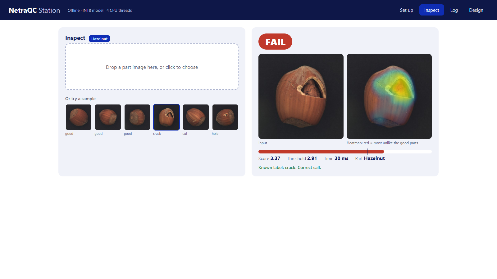
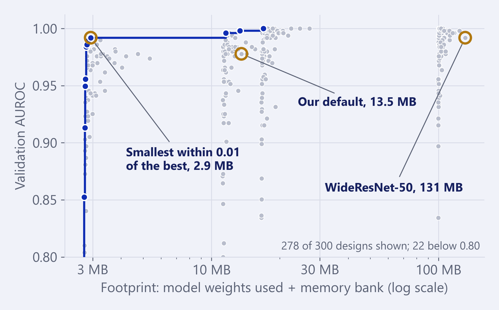

# NetraQC

Surface-defect inspection that a small factory can set up from about 20 photos of good parts.
It learns what a normal part looks like, flags anything that differs, and shows where with a heatmap.
Runs offline on a CPU with a 2.9 MB INT8 model. Inspired by ZEISS SurfMax; a concept by Team Tensor-hive
(IIT Kanpur) for the ZEISS India Hackathon, Beyond Code 2026, theme AI/ML for Advanced Frugal Innovation.
Not a ZEISS product.



## Run the station

```bash
pip install -r requirements.txt
python app.py            # opens http://localhost:8000
```

No dataset download, GPU or internet needed: 15 ready-made part types (from MVTec AD) and sample images ship
in `station/`.

- **Set up**: pick a part type, or teach a new one from 5+ photos of good parts (20 is better).
- **Inspect**: drop a photo or click a sample. You get the heatmap, score vs. threshold, PASS/FAIL and the time.
  Samples have a known label, so the page also tells you when the call was right, a miss or a false alarm.
- **Log**: every inspection goes into SQLite (`station/log.db`), with CSV export.
- **Design**: why the model is this size and why the threshold is set this way.

Tests: `python -m pytest tests -q`

## How it works

1. **Set up (once per part type).** Pretrained ResNet-18 features (layer 2 and 3) of ~20 good photos, reduced to a
   small memory of normal patches with greedy coreset sampling, as in PatchCore (Roth et al., CVPR 2022).
2. **Threshold from good photos only.** Each good photo is scored against the memory with its own patches left
   out; the threshold is a rule over those leave-one-out scores. No defect photo is used before testing.
3. **Inspect.** Each patch of a new photo is compared with its nearest normal patch. The distances form the heatmap,
   the highest one is the score.
4. **Edge model.** The feature extractor is exported to ONNX and quantised to INT8 (`station/export_models.py`).

## Results

All on public benchmarks, laptop CPU limited to 4 threads. Nothing here is measured on a Raspberry Pi or on real
factory parts yet.

### Design chosen by search (`design_optimizer.py`, `design_search_eval.py`)

300 detector designs (backbone × input size × feature depth × memory size × number of good images), chosen on one
half of the metal-nut test set, reported on the other half:

| Design (held-out half) | AUROC | ms / image | Footprint |
|---|---|---|---|
| WideResNet-50, 256 px, layer2+3, 25 % memory | 0.992 | 362 | 131 MB |
| **ResNet-18, 224 px, layer2+3, 10 % memory (ours)** | **0.992** | **67** | **13.5 MB** |
| Smallest within 0.01 of the best on validation | 0.977 | 39 | 2.9 MB |

With 40 of the 300 evaluations, Bayesian search (Optuna TPE) reaches 98.8 % ± 0.5 of the best trade-off
(hypervolume of testing all 300), against 96.0 % ± 3.6 for random search (20 seeds).



### All 15 MVTec AD categories (`run_all_categories.py`)

One fixed design, 20 good images per category, no per-category tuning: mean image AUROC **0.921**, mean pixel
AUROC 0.962. 923 / 1,258 defective images caught, 53 / 467 good images flagged. Ten of 15 categories are at 0.95
or above; the weakest are screw 0.565, grid 0.748, capsule 0.841, pill 0.881 and zipper 0.934.
Per category: `results/all_categories/summary.json`.

### INT8 (`edge_int8.py`)

| Part | FP32 AUROC | INT8 AUROC | ms FP32 → INT8 |
|---|---|---|---|
| metal nut | 0.985 | 0.985 | 21.4 → 14.3 |
| screw | 0.565 | 0.568 | 21.3 → 13.7 |
| carpet | 0.976 | 0.972 | 22.3 → 15.0 |
| capsule | 0.841 | 0.838 | 24.0 → 14.1 |

Model 11.1 MB → 2.9 MB, calibrated on good metal-nut images only.

### Threshold rule (`threshold_study.py`)

Six rules, each computed only from the 20 leave-one-out scores of the good images. Picked on the first half of
every test set by the mean of miss rate and false-alarm rate; counts below are the held-out halves of all 15 categories.

| Rule | Defects missed | Good flagged | Val. error |
|---|---|---|---|
| max (used) | 176 / 648 | 24 / 236 | 0.182 |
| mean+2sd | 156 / 648 | 29 / 236 | 0.184 |
| mean+3sd | 221 / 648 | 18 / 236 | 0.210 |
| mean+4sd | 279 / 648 | 11 / 236 | 0.216 |
| max*1.05 | 211 / 648 | 15 / 236 | 0.199 |
| max*1.10 | 262 / 648 | 8 / 236 | 0.216 |

The rule we already used (`max`) did best, so the station keeps it. Rules that miss fewer defects flag more good
parts. The station's leave-one-out uses one shared coreset with each image's own patches removed (20× faster than
re-sampling per image); the rule choice carries over.

### Weak part types (`weak_types.py`)

Per type: input 224/320 px × feature depth × memory 10/25 %, picked on the first half of the test set, reported on the
held-out half. The station uses the pick only where it beat the default on the held-out half.

| Part | Default | Picked | Design | Used |
|---|---|---|---|---|
| screw | 0.605 | 0.822 | 320 px, layer 2, 25 % | yes |
| grid | 0.751 | 0.700 | 224 px, layer 2, 10 % | no, default kept |
| capsule | 0.789 | 0.906 | 320 px, layer 2, 10 % | yes |
| pill | 0.897 | 0.904 | 320 px, layers 2+3, 25 % | yes |
| zipper | 0.936 | 0.950 | 320 px, layer 2, 10 % | yes |

### Lighting (`eyecandies_lighting.py`)

Eyecandies Lollipop (Bonfiglioli et al., ACCV 2022), cropped to the candy, 320 px, one detector per light:

| Lighting | Image AUROC |
|---|---|
| One shot, all lights | 0.583 |
| One shot, box light | 0.586 |
| Each single directional light | 0.643–0.726 |
| Four directional lights combined | **0.735** |

Directional light reveals more than one evenly lit photo: an early signal for the LED dome, on 50 test
samples (16 defective). The all-lights render cannot be rebuilt from the single-light renders
(28–57 % error), so light combinations must come from linear RAW captures.
Two more classes (Peppermint, Marshmallow) were started but ran out of memory and are not reported; `--auto-crop`
is ready for them.

## Reproduce

```bash
for c in bottle cable capsule carpet grid hazelnut leather metal_nut pill screw tile toothbrush transistor wood zipper; do
  python download_mvtec.py --category $c --n-train 20 --out ../netraqc_data; done
python netraqc_patchcore.py --data ../netraqc_data --category metal_nut --out results   # first demo, heatmaps
python design_optimizer.py --data ../netraqc_data --category metal_nut --out results/design
python design_search_eval.py && python plot_design_space.py
python run_all_categories.py --data ../netraqc_data --out results/all_categories
python threshold_study.py --data ../netraqc_data --out results/threshold
python weak_types.py --data ../netraqc_data --out results/weak_types
python edge_int8.py --data ../netraqc_data --categories metal_nut screw carpet capsule --out results/edge
python eyecandies_lighting.py --root ../eyecandies_data/Eyecandies/Lollipop --out results/eyecandies_crop320 --size 320 --crop 100,480,30,480
python -m station.export_models --data ../netraqc_data
python -m station.build_banks --data ../netraqc_data
```

## Layout

| Path | What |
|---|---|
| `app.py`, `station/` | the station: engine, FastAPI server, page, models, part types, samples |
| `netraqc_patchcore.py` | the original detector and demo frames |
| `design_optimizer.py`, `design_search_eval.py`, `plot_design_space.py` | design search |
| `run_all_categories.py`, `threshold_study.py`, `weak_types.py`, `edge_int8.py`, `eyecandies_lighting.py` | experiments |
| `results/` | every number quoted in the deck |
| `docs/` | decks (idea, mid-sprint, final) and screenshots |

## Data and licences

MVTec AD (Bergmann et al., CVPR 2019) is CC BY-NC-SA 4.0, non-commercial: the sample images and part types in
`station/` come from it and are for research use. Eyecandies (Bonfiglioli et al., ACCV 2022) is used as a research
benchmark; its images are not in this repo. A commercial version would be set up on the customer's own parts.
